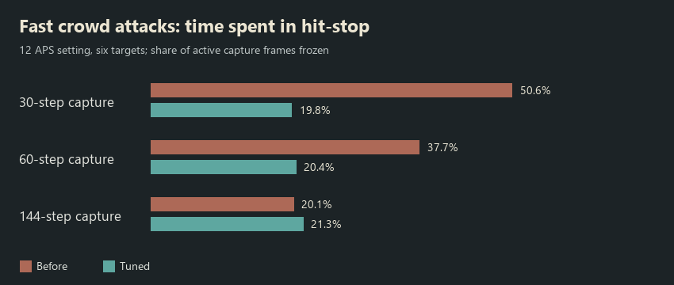

# Step 05 — crowd validation and bounded hit-stop

Completed 2026-10-28. Tested fast attacks, dense groups, multiple projectiles,
return hits, repeated saw/beam contact, menu pause, skill cancellation and
hit-stop backend lifetime. Added a real-time hit-stop duration and a shared
repeat limit. Existing damage, target memory and skill recipe windows remain
authoritative; no skill balance assets were edited.

## What changed

The previous service counted rendered frames and allowed a new request to
increase its remaining frame count. A shared cast gate prevented one cast
from requesting a stop per target, but separate casts could still freeze
too frequently. At the runner's 12 APS cap, the baseline six-target captures
spent 50.6%, 37.7% and 20.1% of active fight frames frozen at configured
capture steps of 30, 60 and 144 respectively.

`HitStopService` now interprets the existing `HitStopFrames` data at a **60 Hz
reference**: 1 = 16.7 ms, 3 = 50 ms, 4 = 66.7 ms, 5 = 83.3 ms. It uses an
unscaled deadline, not a rendered-frame countdown. No serialized field was
renamed and no recipe migration is needed. A regular update can quantize the
deadline by its final frame; an inactive Editor cannot advance a player loop.

The shared `HitStopBudget` permits at most one stop per configured interval,
by default **0.25 seconds between starts**, across different casts and
projectiles. It never extends the active deadline and keeps its interval after
the visible stop ends. A runtime guard also leaves at least 0.05 seconds of
quiet time after the requested duration if the interval is configured too low.
The one-attempt-per-cast gate remains shared by projectile clones and return
passes. A denied presentation request never delays or removes damage.

**Zero now means disabled.** Several existing recipes already used zero, but
the previous clamp silently converted it to one frame. The recipe Inspector
now accepts 0–5. The shared profile also has an **Enable Hit Stop** switch and
**Hit Stop Interval**, in the existing
`Assets/Resources/Visuals/CombatPoseProfile.asset`.

`GamePauseService` releases a transient hit-stop before recording the underlying
time scale for a menu. Opening a menu during a stop can therefore resume an
existing slow-motion scale correctly. Multiple pause handles still have to
close before gameplay resumes. Scene/death pause reset cancels hit-stop too.

The timer is independent of skill coroutines and end-of-frame rendering.
Cancellation cannot orphan it. Disable/destroy restores only its own zero;
another clock owner's nonzero scale or menu pause is preserved. A disabled
backend rejects requests because it has no Update to end a new freeze.

## Measured comparison

| Configured capture steps | Baseline frozen frames | Tuned frozen frames | Baseline / tuned direct hits |
|---|---:|---:|---:|
| 30 | 50.6% | 19.8% | 84 / 102 |
| 60 | 37.7% | 20.4% | 126 / 132 |
| 144 | 20.1% | 21.3% | 156 / 144 |

Every fast cast hit all six targets. Fewer/shorter interruptions change how
many complete casts fit into a wall-clock/capture interval; damage was not
filtered to obtain the comparison. The configured capture rates control
gameplay stepping and are not certification of a monitor's physical refresh
rate. Pure-clock tests separately verify the same nominal duration at 30,
60 and 144 regular updates per second, within one final update of quantization.

## Crowd and repeated-hit results

**15 final live cases passed**, in addition to three baseline captures:

- 12 APS fast attacks at the three configured capture rates.
- 24 enemies with body/flash/recoil disabled and enabled. Enabled: 21 casts,
  **504 direct hits**, exactly 24 per cast; at most **24 reusable recoil
  renderers**, 24 active recoils and 24 simultaneous flashes. All settled idle.
- Near Fan: 5 confirmed arrow hits from one cast.
- Pendulum: **18 hits** across the three passes through six targets.
- Circular Saw: **12 hits**, including repeated contact and return behavior.
- Lightning Rod: **48 hits**, eight passes through six targets.
- Pause during hit-stop, cancellation during hit-stop, and pause while the
  underlying time scale was 0.5. Each recovered its intended state.
- Overlapping independent stop requests were intentionally injected during
  combat; they did not keep extending a stop or leave time frozen.
- Actual Play Mode disable/destroy of the backend during a stop restored time.
  A request to the disabled backend did not create a new orphaned freeze.

The fan, returning disc, saw and beam scenarios did not freeze gameplay: their
existing zero-frame recipes/emitter behavior are respected. Flash and recoil
remain visible on their real repeated hits. No generic contact particles or
additional skill artwork were introduced.

[Actual crowd/return/saw/beam frames](CrowdValidation/contact-sheet.png)

## Performance scope

Measured in the live Unity Editor on **Intel Core i7-12700H / NVIDIA GeForce
RTX 4070 Laptop GPU / Direct3D 11**. The fixture renders at 480×270 while the
normal Hub is also running. Targets' physical roots are constrained; the
24-target case uses increased area of effect and a controlled two-row layout.

Warm samples exclude the first second, screenshot frames and the frames
immediately following them. The isolated probe explicitly samples existing
flash/recoil presenters once more after their normal update; it measures
that code path and native property-block writes, not the entire FX/render cost.

| 24-target probe | Feedback disabled | Feedback enabled |
|---|---:|---:|
| Median flash/recoil sample time | 6.2 µs | 57.6 µs |
| 95th percentile | 9.9 µs | 65.9 µs |
| Maximum managed allocation in the warm probe | 0 bytes | 0 bytes |
| Recoil display renderers | 0 | 24 |

The isolated median difference was about **0.051 ms**. Whole-Editor frame
counters still show allocations from gameplay, skill VFX and diagnostics:
this is not a claim of an allocation-free game. Extra camera render median
was about 3.3/3.2 ms and Editor main-thread median about 16.8/16.5 ms off/on;
the small reversed differences are noise, not a claimed speed-up. This is
not a standalone player-build GPU/overdraw benchmark or an FPS guarantee.
The overlapping-request scenario had an Editor foreground interruption and
is excluded from performance conclusions.

## Regression and artifacts

- Unity compilation passed. **174 EditMode tests passed, 0 failed, 0 skipped**:
  HitStop, GamePauseService, CombatHitFeedback, EnemyHitFlash, CombatPose,
  Pendulum, CircularSaw, LightningRod and NearFan classes.
- Regression cases first reproduced the broken zero-frame behavior. Another
  failing case reproduced accepting a freeze on a disabled backend before
  the new guard was added. The current suite includes duration/quantization,
  global budget, 10,000 allocation-free budget requests, clone ownership,
  menu/slow-motion restoration, lifecycle callbacks and another clock owner.
- The existing Venom Strike data is authored at five reference frames; its
  stale test expectation of three was updated. No recipe was retuned.
- The 13 main after cases preceded the extra disabled-backend guard. That
  guard is covered by the final regression run and two final live lifetime
  cases. The source fingerprints in the summary identify the final version.

[Capture and verification summary](CrowdValidation/audit.json) ·
[Per-case measurements](CrowdValidation/measurements.csv)

Raw frames/traces are in ignored `Logs/CombatCrowdBefore/`,
`Logs/CombatCrowdAfter/` and `Logs/CombatCrowdLifetime/`. The initial baseline's
legacy `initialHealth` field was set before its crowd HP override; the test
actually used one million HP per target, and the final captures correct that
metadata. Freeze/cast/hit measurements do not use that field.

The next planned slice is optional camera feedback, player damage reactions,
visual defense outcomes and death integration. Ranged/casting attacker body
motion and broad accessibility settings remain separate work.
