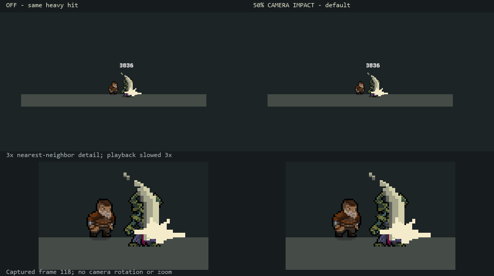
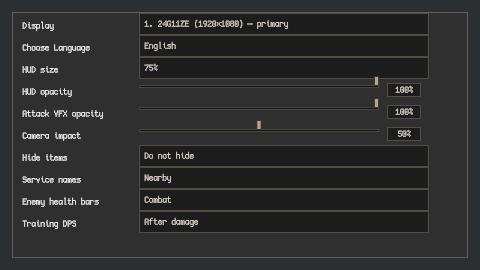
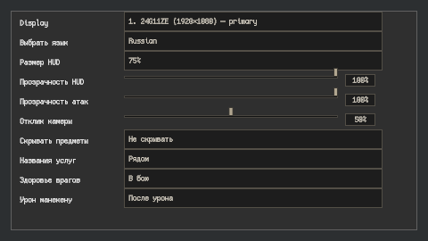
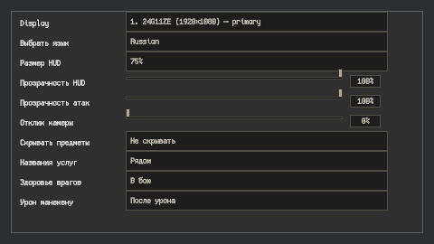
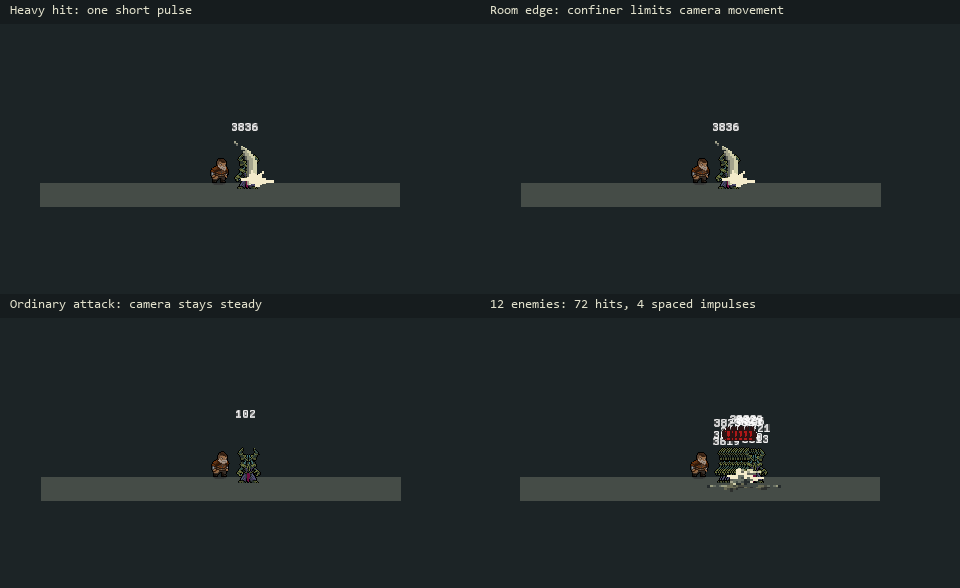

# Step 6 — restrained heavy-hit camera feedback (C11)

Implemented and verified on 2026-10-28 with Unity 6000.3.11f1 / Cinemachine 3.1.5.

Confirmed heavy hits now give a short directional camera nudge. The default is
about one pixel on the 480×270 reference image. There is no rotation, zoom,
random vibration, additional contact particle, or change to combat mechanics.
Ordinary attacks, basic bow hits, DoT, misses and zero-damage contacts do not
request this effect. Parry and elite-kill accents remain later work.

## How to adjust it

Open **Settings → Camera impact** (**Настройки → Отклик камеры**).
The saved slider runs from **0% (off)** to **100%**, with **50%** as the default.
Changes apply immediately. The HUD stays in screen space.

The offset rounds to whole reference pixels: very low strengths can round out
entirely, while intermediate values also change how long the rounded nudge is
visible. This deliberately avoids fractional camera movement in pixel art.

Shared developer tuning is in
`Assets/Resources/Visuals/CombatPoseProfile.asset`: Enable Camera Impulse,
Camera Impulse Pixels (2 at full strength), Duration (0.14 real seconds), and
Interval (0.4 real seconds). These are presentation values, not skill balance.

[Animated on/off comparison](CameraImpulse/heavy-comparison.gif) — actual
480×270 camera captures, with a nearest-neighbor enlarged detail underneath.
Playback is slowed three times so the small displacement can be inspected.

## Behavior and integration

`CombatCameraImpulse` is a Cinemachine extension installed on tracking cameras
when a scene loads. It listens to the existing positive direct-hit confirmation.
It requires a living, enabled player matching that camera's follow target, a
visible hit, an attack context and the existing Heavy impact classification
(damage multiplier ≥2). A critical ordinary hit does not automatically qualify.

Each accepted attack context permits one attempt across all targets, projectile
clones and repeat passes. A suppressed attempt is consumed, so the same cast
cannot produce a late pulse after the interval expires. One camera signal runs
at a time; incoming hits cannot add to it or extend it. The minimum quiet gap is
also bounded when profile values are set outside the Inspector ranges.

The pulse implements Cinemachine's `ISignalSource6D` and enters its state before
the Body stage. The existing composer continues following the player; the
existing confiner constrains the corrected viewport afterward. It does not move
Main Camera directly or change the follow target. This scoped signal uses a
local unscaled clock instead of changing the global ImpulseManager clock or
clearing other sources' events. Hit-stop therefore preserves the short camera
response; a real menu pause cancels it.

Disabling the component/profile/setting, changing follow target or room bounds,
warping the camera, disabling the owner or reaching zero health clears the
response. The camera correction returns exactly to zero rather than accumulating
into a new follow position. Runtime settings are cached through the existing
presentation-settings change event. UI text follows the existing EN/RU settings
pattern; no scene, prefab, material, weapon or skill balance asset was changed.

## Verification

Compilation passed. **115 EditMode tests passed, 0 failed, 0 skipped**, using:

- CombatCameraImpulseTests; CombatHitFeedbackTests; HitStopTests.
- GamePauseServiceTests; WorldInformationVisibilityTests.
- DungeonBackgroundTests; CombatPoseTests.

Coverage includes once-per-cast ownership, 1,000 competing requests, quiet
interval, exact neutral return at simulated 30/60/144 sampling rates, invalid
input, whole-pixel bounds at Hub/dungeon zooms, visibility rejection, saved zero
and the existing scrollable Settings layout. Dungeon-background regressions
cover zoom restoration and parallax anchoring.

**Eleven final live cases passed**, using real skill recipes and a Cinemachine
Brain with the Hub's LateUpdate / IgnoreTimeScale=false settings:

| Case | Hits | Camera pulses | Result |
|---|---:|---:|---|
| Heavy, off | 1 | 0 | Camera steady |
| Heavy, default | 1 | 1 | About one reference pixel, including during hit-stop |
| Ordinary attack | 1 | 0 | Camera steady |
| Basic bow | 1 | 0 | Camera steady |
| Left room boundary | 1 | 1 | Nudge permitted toward room interior |
| Right room boundary | 1 | 1 | Requested offset constrained to zero movement |
| Menu pause during pulse | 1 | 1 | Clears without delayed replay |
| Slider switched off during pulse | 1 | 1 | Clears immediately |
| Room bounds changed during pulse | 1 | 1 | Clears for the new room |
| Rapid casts into 12 enemies | 72 | 4 | Six casts; no stacking; all hits delivered |
| Owner health set to zero during pulse | 1 | 1 | Clears without invoking save/death flow |

All 1,980 recorded camera viewports remained inside their test room bounds.
All cases settled to zero correction. The heavy off/on pair delivered identical
damage (3835.5869) at the same contact frame. Final console errors were empty.

[Compact measurements and source SHA-256 fingerprints](CameraImpulse/audit.json).
Raw frame traces and screenshots are ignored under `Logs/CombatCameraImpulse/`;
live UI captures are under `Logs/CombatCameraSettings/`. Explicit Editor helpers:
`CombatBaselineCapture.BeginCameraReview` and `CombatCameraSettingsCapture.Begin`.
They create temporary fixtures, restore preferences and do not save scenes.

The crowd fixture temporarily clones the hammer skill with zero cooldown and
uses 12 base APS / +200% AoE; the shipped skill remains unchanged. The quiet
interval uses real time, so the exact number of suppressed pulses can differ
between Editor runs even with the same number of simulated casts. Earlier runs
produced three pulses; the final recorded run produced four. Both obey the same
bound. This is controlled Editor validation, not a standalone build, GPU profile
or a claim to have inspected every room in motion. The UI was captured before
the final owner-health guard; its UI sources are unchanged and fingerprinted.

The next step is **C12: clearer feedback when the player takes damage**, composed
with existing attack, dodge and spin presentation without adding gameplay stun.
