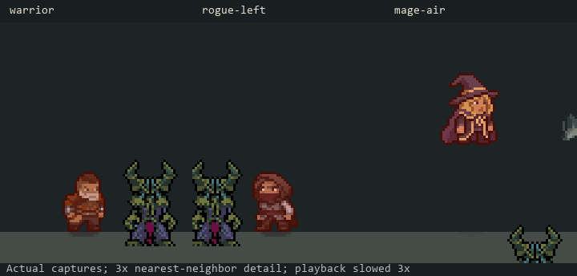

# Step 7 — player damage response (C12)

Implemented 2026-10-28. Positive direct damage to the player produces a short
warm red highlight and small body recoil. There is no new hitstun, movement
impulse, camera shake, particle burst, or attack cancellation.

[Animated preview: Warrior, Rogue and Mage](PlayerHurt/player-hurt.gif).
These are actual game captures enlarged with nearest-neighbor sampling and
slowed three times. The mage fixture is airborne; the Rogue faces left.

The existing DamageTaken event drives one bounded pulse. DoT, zero damage,
evasion, parry and immunity do not request it. A Mystic Shield hit still produces
hurt if some direct health damage gets through; shield-only feedback belongs
to C13. Lethal hits clear the pulse, leaving the death flow authoritative.

PlayerMovementVisual composes the body recoil with attack and movement shaping,
with feet compensation. Dodge, spin and stasis take priority over hurt deformation;
the shader highlight remains independent. Collider/root, hand/weapon animation,
input, damage and defensive windows are unchanged. The flash uses the existing
independent hit-flash channel without replacing materials or status tint/emission.
Unsupported custom shaders remain unchanged. Scaled time pauses the response in
menus and hit-stop. Disabling the visual/profile, changing class or reaching zero
health clears its state.

Tuning: select `Assets/Resources/Visuals/CombatPoseProfile.asset` in Unity and open
**Player damage response**. Defaults: enabled; flash 0.4; duration 0.1 seconds;
retrigger interval 0.22 seconds; body lean 2 degrees; compression 2%. This is
shared across classes. There are no new player-facing labels requiring locales.

Compilation passed. **100 EditMode tests passed, zero failed/skipped**:
PlayerHurtFeedbackTests, ShieldParryTests, CombatPoseTests, EnemyHitFlashTests,
GroundDashVisualTests. Pulse tests cover accepted direct hits, retrigger spam,
neutral return, defense events, DoT, zero damage, other targets and profile-off.
Existing tests cover parry mechanics and attack/dodge presentation regressions.

**Seven controlled live cases passed:** Warrior, left-facing Rogue, airborne
Mage, rapid incoming hits, zero damage, pure DoT and profile-off. Positive cases
reached 0.4 flash; excluded cases remained zero; all settled to zero. Final
console errors were empty. These checks do not claim a full standalone build or
every combination of skills and statuses.

[Measurements and source fingerprints](PlayerHurt/audit.json).
Raw traces/screenshots: ignored `Logs/CombatPlayerHurt/`. Reproduce in Play Mode
with `RelicKeeper.Editor.Combat.CombatBaselineCapture.BeginPlayerHurtReview`.
The fixture temporarily disables editor immortality and restores its original
value afterward; it does not save scenes or invoke player death/save handling.

Next: C13, distinct feedback for successful defenses.
