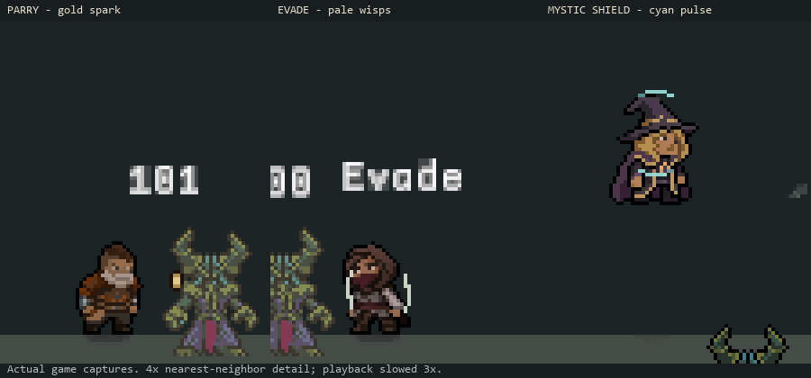

# Step 8 — successful defense feedback (C13)

Implemented and checked on 2026-10-28, Unity 6000.3.11f1.

Successful defenses now have distinct compact accents:

- **Parry:** a brief gold metal spark on the attacker's side, beside the body/guard.
- **Evade:** two pale wisps shimmering along the character's sides.
- **Mystic Shield:** a cyan pair of expanding arcs when charges are consumed.

[Animated game preview](DefenseFeedback/defenses.gif). Native 480×270 captures
are enlarged with nearest-neighbor sampling and slowed three times. The first
column uses Warrior, the second a left-facing Rogue, the third an airborne Mage.

The parry skill's existing activation effect remains. These new accents report
the successful outcome, using the existing Parried, Evaded and
MysticShieldConsumed events. No damage, defenses, retaliation, movement, attack
timing, time scale, or invulnerability rules were changed. The effects neither
hide the player nor use the red hurt channel.

## Shield and damage semantics

A shield charge can reduce damage without absorbing all of it. Partial damage
therefore shows both the cyan charge pulse and C12's red health-damage response.
A full absorption shows only cyan. Depleted shields do not produce a charge
pulse. Failed defense, unrelated targets and ordinary DamageTaken events do not
request any extra defense accent. Evade/parry classification requires a positive
direct-hit snapshot, so a DoT immunity notification cannot imitate an evade.

The existing charge event also covers **charges spent by skills** and charge
consumption during DoT mitigation. Those uses produce the same compact cyan
consumption pulse; the event does not distinguish why the charge was spent.
This implementation does not change that existing gameplay event contract.

## Controls and lifetime

Select `Assets/Resources/Visuals/CombatPoseProfile.asset` in Unity. Under
**Successful defenses (PixelLab accents)**:

- Enable Defense Feedback turns all three accents on/off.
- Defense Feedback Opacity defaults to 0.85.
- Defense Feedback Interval defaults to 0.3 seconds, per outcome kind.

Each kind owns one reusable child SpriteRenderer: at most three for one player.
Retriggers cannot extend an active response or queue a late replay. Clips last
about 0.17–0.2 scaled seconds; menus/hit-stop hold their frame. Death/zero health,
class changes, disabled player presentation, profile-off and large teleports
clear the response. Child objects are cleaned up with their owner. Geometry and
position follow the displayed body rather than the collider or weapon animation.

Sprites use the existing PlayerOverlay render category and World Color Unlit
shader. The shared material is saved as a resource, preserving its build
dependency. Textures are point-filtered, uncompressed and have no mipmaps, at
24 pixels per unit. An Editor importer reads the original PixelLab JSON, including
frame rectangles and pivots. Runtime code uses imported sprite subassets, not
new textures or dynamically generated per-hit materials.

There are no new player-facing strings; existing EN/RU defense descriptions and
the evade popup remain unchanged.

## PixelLab sources

All three new sprite animations were authored and exported through PixelLab's
VFX workbench. Their original PNG/JSON exports are retained under
`Assets/Resources/Visuals/DefenseFeedback/`. Open the source effects in PixelLab:

- [Parry success](https://pixellab.ai/create-vfx?effect=c92ac672-c466-4ff8-b83b-f50cdb7fa501)
- [Evasion shimmer](https://pixellab.ai/create-vfx?effect=76c0bd4c-93b9-4773-a6dc-6546e8ddf8f1)
- [Mystic charge pulse](https://pixellab.ai/create-vfx?effect=8d738a84-9ce3-4e7e-a5fc-13eeefa79700)

## Verification

Compilation passed. **121 EditMode tests passed, zero failed/skipped**:
DefenseFeedbackTests, PlayerHurtFeedbackTests, ShieldParryTests, CombatPoseTests,
GroundDashVisualTests, EvasionMitigationTests, MysticShieldSkillEffectivenessTests
and MysticShieldRepriseTests.

New tests cover event classification, wrong targets, DoT, zero damage, empty
charge consumption, damage/defense separation, 1,000 rejected retriggers per
kind, independent lanes, cleanup, ordered sprite imports and material wiring.
The warmed pure pulse scheduler/sample loop allocated **zero managed bytes**
over 9,999 accepted triggers. This is not a claim that the full event/rendering
path or game has zero allocations.

**Twelve controlled live cases passed**:

| Case | Accepted accents | Hurt flash |
|---|---:|---|
| Warrior parry | 1 | None; health preserved |
| Left-facing Rogue evade | 1 | None; health preserved |
| Airborne Mage, fully absorbed shield hit | 1 | None; health preserved |
| Four rapid parries | 2 | None |
| Partial shield absorption | 1 | Present with cyan pulse |
| Depleted shield | 0 | Present for health damage |
| Pure DoT without shield charges | 0 | None |
| Zero damage | 0 | None |
| Profile disabled | 0 | None; parry mechanics still work |
| Menu pause | 1 | None; frame holds during pause |
| Class change during response | 1 | Clears |
| Zero-health state during response | 1 | Clears |

All cases settled to zero active responses; final console errors were empty.
The zero-health fixture uses SetCurrent(0), avoiding death/save handling; ordinary
fixture regeneration can subsequently raise its health again. Final health
measurements elsewhere also include regeneration; they are not damage totals.

[Compact results and source fingerprints](DefenseFeedback/audit.json).
Ignored raw traces/screenshots: `Logs/CombatDefense/`. Reproduce in Play Mode
with `RelicKeeper.Editor.Combat.CombatBaselineCapture.BeginDefenseReview`.
Fixtures restore the editor immortality setting and do not save scenes.
This is Editor validation, not a standalone build or GPU performance profile.

Next: **C14**, coordinate lethal impact feedback with the existing enemy death
effects so the final blow reads clearly without duplicate full effects.
