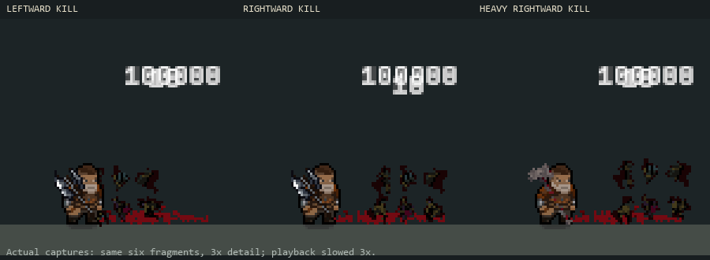

# Step 9 — fatal-hit/death handoff (C14)

Implemented and verified 2026-10-28.

The existing death fragments now favor the killing hit's confirmed direction.
Heavy impact classification increases their impulse by 25% by default. The same
fragments, counts, blood layout, room pools, quality settings and caps are reused;
there is no added contact burst or new art.

[Animated preview](LethalHits/lethal-hits.gif): controlled leftward, rightward and
heavy kills. Native captures enlarged by nearest-neighbor sampling, slowed 3x.

The fatal context is an immutable value snapshot, captured before damage-event
callbacks can mutate a shared damage object or move its attacker. It uses the
existing confirmed-hit direction, with the existing attacker-position fallback;
this is not a newly measured collision normal. Only the fatal hit supplies the
context. Damage-over-time deaths use the original neutral radial spread rather
than inheriting an earlier direct hit. Resurrection resets the context and kill
source.

Living recoil and hit flash clear before death callbacks and fragment spawning,
including DoT deaths. EnemyHealth's ordinary hit-reaction request skips a terminal
hit. Existing stun rules remain unchanged. EnemyHealth rejects further hits once
health is terminal, including reentrant calls from the fatal damage notification.
The death method also guards repeated invocation. This preserves one fatal
confirmation and one death/kill notification rather than allowing nested contacts
to overwrite the terminal context. Health calculations, execution thresholds,
reward amounts, death-event order and immediate death timing remain unchanged.

A second terminal check after mitigation callbacks covers a nested kill triggered
by shield consumption before the outer hit reaches health. This guard was added
after the live captures and is covered by the final 142-test suite; it does not
change their visual behavior.

## Tuning

Select `Assets/Resources/Visuals/CombatPoseProfile.asset`, then **Death fragment
impulse — existing debris only**:

- Enable Directed Deaths toggles the directional/heavy presentation.
- Death Direction Bias defaults to 0.8: blend the original radial spray toward
  the final direct hit's direction. Vertical attacks can direct debris downward.
- Heavy Death Impulse defaults to 1.25 and is capped at 1.5.

Profile-off and non-direct deaths retain the neutral spread. These options only
affect cosmetic fragment forces. Heavy means the existing impact classification
(skill damage multiplier at least 2), not every critical hit or every heavy weapon.
No player-facing text or localization keys were added.

## Verification

Compilation passed. **142 EditMode tests passed, zero failed/skipped** across
LethalHitPresentationTests, CombatHitFeedbackTests, EnemyDeathRemainsTests,
EnemyHitFlashTests, CombatPoseTests, NearFanTests, CircularSawTests and
PendulumTests. New coverage checks all radial fragment angles for horizontal
direction, heavy multiplier/cap, neutral/DoT/off behavior, mutable damage snapshots,
reentrant/repeated hits, resurrection reset and DoT cleanup before callbacks.
Existing remains tests cover pooled reuse, collision rules and effect budgets.

**Seven live cases passed:** rightward, leftward, heavy, DoT, frozen, twenty
repeated contacts after the fatal hit, and an actual multi-arrow Near Fan kill.
Every case produced exactly one death callback, one kill event and the existing
six-fragment effect; living feedback was clear at death. Twenty late contacts
were rejected. Final console errors were empty.

[Results and source fingerprints](LethalHits/audit.json).
Raw traces/screenshots are ignored under `Logs/CombatDeath/`. Reproduce in Play
Mode with `RelicKeeper.Editor.Combat.CombatBaselineCapture.BeginDeathReview`.
Six fixtures inject receiver-side damage; Near Fan uses its real recipe and
projectiles. Fixtures grant no rewards, restore immortality settings and save no
scenes. This is controlled Editor validation, not a standalone build, GPU profile
or a claim to have reviewed every enemy/skill pairing visually.
