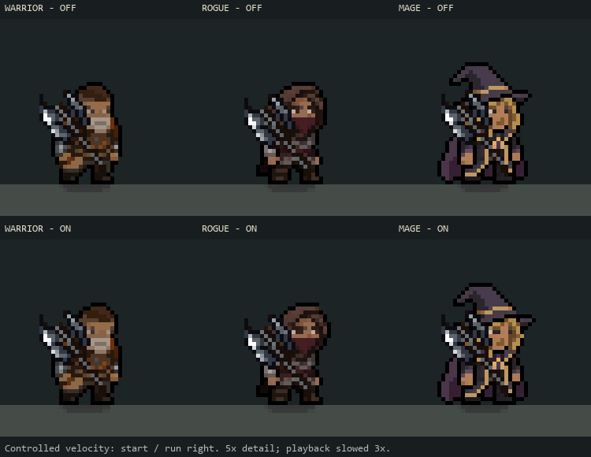

# Step 10 — ground movement weight (M01)

Implemented 2026-10-28. Starting and braking now produce small opposite body
leans; reversing direction adds a brief compression/settle. Steady running eases
back to its existing pose. The new layer changes only the displayed body, with
foot compensation. Movement physics, acceleration, input, collider, hand sockets
and weapon animation are unchanged.

[Animated on/off comparison](MovementWeight/movement-weight.gif).
Warrior, Rogue and Mage are shown at five-times nearest-neighbor enlargement,
with playback slowed three times. These are controlled velocity-trace previews
on stationary actors, not recordings of physical movement input.

## Behavior

The pose follows the difference between actual velocity and a short filtered
velocity history. It therefore settles during constant-speed travel and does
not keep leaning when input is held against a wall. Lean is stored in world
direction and converted to local facing at composition time, avoiding a sudden
world-lean reversal when the character flips. Intent changes add a 0.12-second
turn-settle contribution when the actor is already moving.

Attack/cast ownership, dodge, dash, spin, stasis, movement lock, airborne state
and hurt feedback take priority. Suppression clears movement history; resuming
at a steady velocity does not invent a new start impulse. Disabling the visual,
zero health, class changes and large teleports also reset it. Menu pause and
hit-stop hold the existing pose through scaled delta time.

This adds no particles, trails, new sprites or authored animation clips. Existing
class run/idle/jump animations remain authoritative.

## Tuning

Select `Assets/Resources/Visuals/CombatPoseProfile.asset` in Unity. Under
**Ground movement weight — body only**:

- Enable Movement Weight turns this layer on/off.
- Movement Lean Degrees defaults to 3 (hard bound 4).
- Movement Compression defaults to 0.012 (1.2%, hard bound 2.5%).
- Turn Compression defaults to 0.02 (2%, hard bound 3%).

These are visual settings, shared by all classes. They do not change movement
speed, acceleration or input timing. There are no new player-facing labels or
localization keys.

## Verification

Compilation passed. **110 EditMode tests passed, zero failed/skipped**:
MovementWeightShiftTests, CombatPoseTests, PlayerMovementTests,
GroundDashVisualTests and PlayerHurtFeedbackTests.

New pure-state cases cover start/brake direction, neutral settling at 30/60/144
sampling rates, facing flips, pause, wall contact, reversal, suppression/resume,
profile-off and extreme speed/tuning bounds. Six integration cases cover all
three classes facing both ways: feet remain anchored; root position, velocity
and hands remain unchanged; an attack immediately suppresses movement weight.
Existing tests retain spin, dodge, dash, stasis and physical movement coverage.

**Nine live cases passed:** off/on pairs for Warrior, Rogue and Mage, a moving
attack, airborne state and movement lock. The same supplied root/velocity trace
is used in each class's on/off pair. Enabled cases peaked below 3 degrees;
disabled/air/locked cases stayed neutral. Every recording settled after stopping,
and the attack recording remained neutral while casting. An initial attack
recording ended early because the shared cast helper shortened the capture;
the final recording runs the complete sequence and passes.

[Measurements and source fingerprints](MovementWeight/audit.json).
Ignored raw traces/images: `Logs/MovementWeight/`. Reproduce in Play Mode with
`RelicKeeper.Editor.Combat.CombatBaselineCapture.BeginMovementReview`.
The temporary fixture supplies velocity/intent and explicitly samples the real
class animation once per frame. It does not save scenes or change game movement
data. This is Editor presentation validation, not full physical-input playback,
a standalone build or GPU profiling. Final console errors were empty.

Next in the plan: review M02/M03 landing and footstep presentation, changing them
only if the live comparison reveals a gap.
