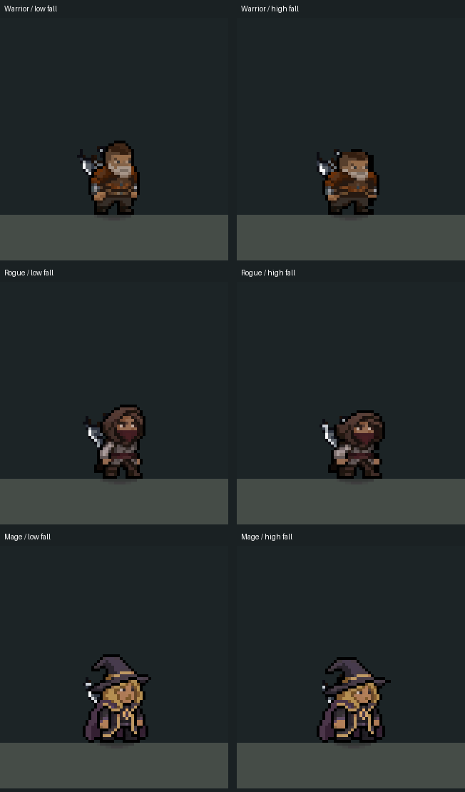

# Step 11 — landing strength and foot contact (M02/M03)

Implemented 2026-10-28. Existing class landing poses now respond to the approach
speed of the fall. Small drops give a light settle; larger drops reach the
authored pose. Run dust starts on a displayed planted-foot frame, subject to
the existing surface travel, interval, speed and density limits.

[Animated small/large fall comparison](LandingContact/landing-contact.gif).
Warrior, Rogue and Mage, four-times nearest-neighbor enlargement, slowed three
times. The columns align the strongest landing frame of each real physical
drop; the animation is not an on/off comparison.

## Findings and changes

Surface dust already scaled with fall speed and had separate earth/stone clips.
The body played the same class landing after every fall. Dust used rendered
frame velocity history, while the body received the physics landing event.
Running dust used distance without checking which foot pose was displayed.

PlayerMovement now retains the last airborne downward velocity and publishes
LastLandingSpeed before its existing landing event, preserving the approach
when collision has already zeroed velocity. This is presentation data only;
movement forces, jump count, buffer/coyote windows and collision rules are
unchanged. Teleport and disable clear the saved approach speed.

The class controller blends its existing landing scale curve from neutral by
that speed. Maximum response is the authored class pose, including the Mage's
lighter compression. The non-authored visual fallback uses the same strength.
Quiet contacts skip the landing recovery pose. Existing foot registration and
grip offsets use the blended scale. New jumps interrupt immediately; a ground
dash releases the landing pose, while neutral dodge/spin retain their existing
presentation priority.

Player landing dust now starts at the physics contact event. A buffered jump
can leave the ground during that same physics step without losing the dust or
mistaking its takeoff for an air jump. Generic enemy grounding retains its
existing sampling path. No extra particle layer or new art was added.

Run contact markers use zero-based frames 2/6 for Warrior and 0/4 for Rogue and
Mage, selected from the current art. Only entering the displayed marker frame
advances the contact version; skipped animation frames do not queue dust for
later. Surface spacing still applies, so a visible step need not emit dust.
A half-source-pixel distance tolerance avoids missing a marker because physics
travel was 1.599 rather than 1.6 units. Airborne, stationary and dodge filtering
and the surface visibility/density controls remain active.

## Tuning

Select `Assets/Resources/Visuals/CombatPoseProfile.asset`. Under **Landing weight
— blends existing class poses**:

- **Quiet Landing Speed:** 2 units/second. At or below this, no landing squash.
- **Full Landing Speed:** 14 units/second. At or above this, use the full class pose.
- **Landing Pose Strength:** 0–1, a shared multiplier for the blend.
- **Enable Landing Weight:** off restores the original fixed-strength class pose.

Foot Contact Frames live in each character's Run Animation data. Surface dust
density remains in World Appearance; the earth/stone surface assets retain
their spacing and art. These are editor controls; no player-facing strings or
localization tables changed.

## Verification and limits

Compilation passed. **151 EditMode tests passed, zero failed/skipped**, covering
LandingContactTests, SurfaceMovementTests, all three class animation suites,
PlayerMovementTests, GroundDashVisualTests, MovementWeightShiftTests and
CombatPoseTests. After the final sub-pixel stride adjustment, the **15 landing
and surface tests passed again**. Tests cover collision-zeroed velocity, a
subsequent lighter fall, teleport/disable reset, tiny/large/bounded class poses,
recovery, immediate jump/dash, authored contact phases and same-step landing
plus ground takeoff without duplicate dust.

**Eleven final live cases passed:** low/high drops for all classes, three run
cases, buffered landing/jump and a tiny drop. The drops use actual Rigidbody2D
gravity and ground probes. Running uses a controlled 5-unit/second motion
override over a temporary floor; it is not keyboard-input playback. The fixture
uses default surface density, not the user's saved Hub sliders, and preserves
the saved scene.

Low drops approached at 3.77 units/second and produced about 1–2% compression;
high drops approached at 12.18 and produced about 6–12%, depending on class.
Each normal drop emitted one landing effect. Run cases exercised 3/4/4 dust
contacts, all coinciding with newly displayed planted frames. The tiny contact
had no landing dust or compression, and the buffered jump fired immediately.

[Compact measurements and source fingerprints](LandingContact/audit.json).
Ignored raw captures: `Logs/LandingContact/`. Reproduce in Play Mode with
`RelicKeeper.Editor.Combat.CombatBaselineCapture.BeginLandingReview`.
This is Editor presentation/physics validation, not a standalone build, full
room traversal or GPU profile. No scenes/prefabs were saved by the fixture.

Next candidate: M04, compare restrained camera look-ahead/follow against the
current camera before choosing any default change.

## Follow-up — sliding pose after a moving landing

User review found that forward movement continued under the fixed landing
sprite for the full recovery clip (about 0.3 seconds). The run animation now
resumes on the first grounded update with horizontal motion; starting to move
during stationary recovery also interrupts it. Stationary landings retain the
full class pose, and the existing short visual pulse can settle over running.

The physics landing event confirms animation ground contact immediately,
including quiet contacts, rather than adding the raw-probe confirmation delay
after a known landing. Taking off or losing ground clears that confirmation.
Physics speed, acceleration, braking and jump rules are unchanged.

Six new regression cases reproduced the frozen landing pose before the fix
(three classes, both directions). **102 focused tests passed** after the fix,
including moving/quiet contacts, movement during recovery, stationary landings,
jump/dodge transitions and the existing surface checks.

**Fourteen live cases passed** on the final revision: the original eleven plus
moving landings for Warrior, Rogue and Mage. Each moving case displayed only
run frames from its first grounded frame onward and advanced through the full
run cycle. The motion override supplies horizontal travel while real gravity
and ground probes resolve the fall. No scene edits were saved.
[Moving landing preview](LandingContact/moving-landing.gif) and
[regression measurements](LandingContact/moving-landing-audit.json).
