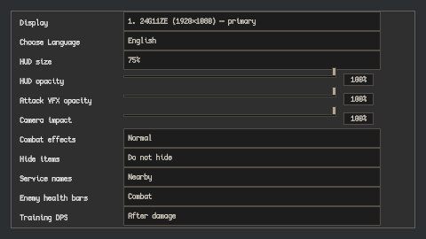
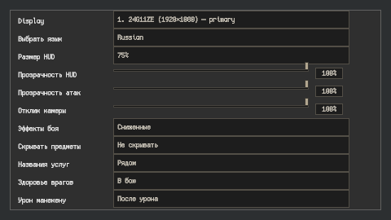

# Step 16 — shared feedback limits and Reduced combat effects (C18)

Implemented 2026-10-29. **Settings > Combat effects > Normal / Reduced** is a
saved, immediately applied choice, localized in English and Russian. Normal
is the default. The row uses the existing Settings UXML/USS and pixel font.

## Scope

| Feedback | Normal | Reduced |
|---|---|---|
| Simultaneous enemy hit flashes | Shared maximum 8 | Shared maximum 3 |
| Enemy hit highlight | Existing strength/interval | Half strength; interval at least 0.35 seconds |
| Player hurt highlight | Existing strength | Half strength |
| Parry, evade and Mystic Shield accents | Existing opacity | Half opacity, still visible |
| Camera impact | Existing saved slider value | Half the effective strength; pixel rounding still applies |
| Flying death fragments | Existing quality/room budgets, up to 6 | Also capped at 2 per death |

The shared flash limit measures active pulses, not pooled object count. Leases
release when pulses finish, objects disable/die or settings change; destroyed
owners are pruned before new admission. Changing the setting clears current
enemy flash pulses so the new mode takes effect immediately. Shared tuning is
in CombatEffectsPolicy; the existing per-target cooldown also remains active.

Damage confirmations still run for every hit even when its cosmetic flash is
denied. Attack VFX, enemy projectiles/warnings, hitboxes, status application,
damage, mana, cooldowns, input/cast timing and the existing hit-stop rules are
unchanged. The Attack VFX opacity and Camera impact preferences keep their own
saved values. Death silhouettes/static remains and existing room death budgets
remain in place. This is a combat-feedback preset, not a global graphics-quality
setting or a budget for every skill's authored particles/projectiles.

## Verification

Compilation and **126 EditMode tests passed**, zero failed/skipped:
ReducedCombatEffectsTests, EnemyHitFlashTests, PlayerHurtFeedbackTests,
DefenseFeedbackTests, CombatCameraImpulseTests, EnemyDeathRemainsTests,
PendulumTests, CircularSawTests, LightningRodTests and NearFanTests. After
centralizing policy values and isolating the normal-mode baseline from the
user's saved preference, the **25 flash/policy tests passed again**.

The tests include 10,000 budget requests, duplicate release/admission, exact
3/8 visible-flash counts across 24 renderers, continued confirmation of all 24
hits, pulse expiry, immediate live-setting cleanup, material preservation,
preference persistence and preserving the independent opacity/camera choices.
Initial integration checks exposed stale destroyed-owner leases; the budget
now prunes them. Another fixture needed explicit EditMode enable/disable calls
to exercise live settings subscriptions. Existing normal-flash tests now save
and restore the Reduced preference rather than inheriting a user's choice.

**Live native UI checks passed** at 480x270: English, Russian, live locale
switching and a real NavigationSubmitEvent on the mode button that persisted
Reduced. Screenshots show both translations inside the existing layout. The
temporary capture restores locale and all preferences it touches, then removes
its UI objects. Reproduce in Play Mode with
`RelicKeeper.Editor.Combat.ReducedEffectsSettingsCapture.Begin`.

[Audit and source fingerprints](ReducedEffects/audit.json).
Raw UI captures are ignored in `Logs/ReducedEffectsSettings/`. This is not a
new full live-crowd replay, hardware latency measurement, standalone build or
GPU/overdraw profile. The earlier C09 crowd recordings remain separate evidence.

The referenced pixel-UI skill file was absent from the installed skill paths;
the implementation follows the existing Settings skeleton, shared styles and
480x270 panel instead. No new artwork or icons were created.

C18 now has the shared flash budget and user-facing reduced-feedback preset.
Broader budgets for arbitrary authored skill VFX and full build performance
profiling remain separate follow-ups; essential attack visuals are not culled.
