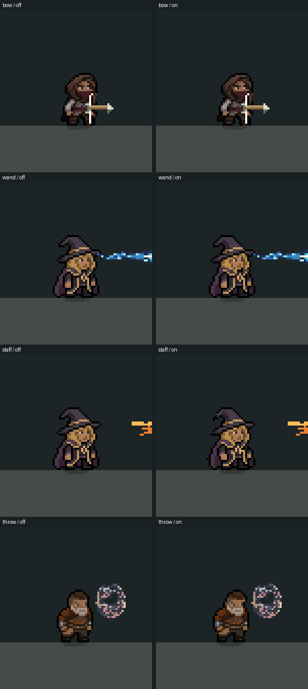

# Step 17 — ranged/casting body follow pilot (C02 expansion)

Implemented 2026-10-29 for Simple Bow Shot, Mana Spear, Flaming Spear and A Fan
of Sickles. These four skills explicitly opt into a ranged body style. Other
skills keep their current eligibility and presentation.

[On/off recording](RangedBody/ranged-body.gif), four-times nearest-neighbor
enlargement at three-times slowed playback. Native 480x270 frames are cropped
around the actor. This is actual skill execution in a controlled review scene.

## Motion

| Skill | Wind-up | Release |
|---|---|---|
| Simple Bow Shot | 1.5° backward lean | 1.5° forward lean |
| Mana Spear | 0.25° forward preparation | 1.5° backward recoil |
| Flaming Spear | 1° backward brace, 1% compression | 2.5° backward recoil |
| A Fan of Sickles | 1° backward preparation | 2° forward lean |

Recovery eases the sampled release pose to neutral using the existing weapon
recovery phase. The weapon's existing wind-up/strike/recovery callbacks drive
the body; no new timer delays or retimes the attack. The runner supplies its
resolved cast duration. Casts shorter than 0.5 seconds proportionally reduce
the body strength, with a minimum 35% of the normal amplitude.

There is one release response per accepted cast. Additional projectiles and
their hits do not restart it. Unsupported/parallel/channel recipes remain
excluded. The ordinary melee path is unchanged. Existing body composition
retains feet registration, hurt/dodge/spin/stasis priority and cancellation/
class-change ownership rules. Only the displayed body is transformed.

No character sprites, skill icons or VFX art were added. The four skill assets
gain only their Body Follow Style selection. Recipe timings, projectile
settings, hitboxes, root movement, weapon animation, damage, mana and cooldown
data are unchanged.

## Tuning

Use `Assets/Resources/Visuals/CombatPoseProfile.asset`:

- **Enable Ranged Body Follow** controls the pilot's eligibility for new casts.
- **Ranged Body Strength** scales the amplitudes from 0 to 1 for new casts.
- **Enable Body Follow** remains the shared master visual switch.

Each selected skill's Body Follow Style is an editor asset field, default None
for existing content. The current pilot supports Bow, Wand, Staff and Throw;
it requires one projectile step, one release and authored preparation/recovery.
There are no new player-facing labels or localization changes.

## Verification

Compilation and **111 focused EditMode tests passed**, zero failed/skipped:
RangedBodyFollowTests, CombatPoseTests, FlamingSpearTests, FanOfSicklesTests,
GroundDashVisualTests and MovementWeightShiftTests. New checks cover all four
recipes, motion direction/bounds, rapid scaling, duplicate-strike rejection,
cancel/stale ownership, unchanged recipe data and root/collider/feet/hand
registration for each selected skill, both facings and grounded/airborne state.

The broader initial test selection also exposed **three existing ManaSpearTests
failures**: CountForkAndChainDoNotMultiplyOrBendTheSpear and the (0,1)/(1,2)
PierceBudget cases. Those tests expect finite piercing, while the unchanged
recipe enables InfinitePierce. `git show HEAD:Assets/Resources/Skills/1HWeapon/Wand/ManaSpear/Recipe_ManaSpear.asset`
contains the same enabled flag. This presentation slice does not resolve that
pre-existing data/test disagreement or silently retune piercing. The old pose
exclusion test was updated because Mana Spear is now deliberately opted in.

**Fourteen final live cases passed:** four standing off/on pairs, running bow,
airborne wand/disc, left-facing staff, fast wand and cancellation. Standing
off/on recordings have zero differences in hand position/rotation, weapon
position, owner position and recipe phase at matching frames. Peaks are 1.5°
bow/wand, 2.5° staff and 2° throw. A six-times-speed wand cast resolves to
0.167 seconds and peaks at 0.525°. Cancellation clears body ownership and pose.
An earlier fast fixture set CastSpeed's base value, which the spell calculation
does not use as an increased modifier; the final capture uses PercentAdd and
explicitly validates both shorter duration and smaller motion.

[Measurements and source fingerprints](RangedBody/audit.json). Raw frames/traces
are ignored in `Logs/RangedBody`. Reproduce in Play Mode with
`RelicKeeper.Editor.Combat.CombatBaselineCapture.BeginRangedReview`.

The fixture executes real recipes/projectiles but constrains actor roots and
supplies velocity for the running pose; air cases hold a stationary airborne
actor. It records an existing weapon-family sprite proxy per case, not a full
equipment/skin matrix. This is not physical-input traversal, a standalone build
or a GPU profile. The four opt-in styles should be reviewed before expanding
to further ranged/casting recipes.
