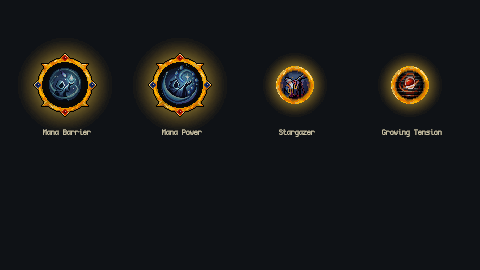

# Mage tree completion — 2026-11-01

Completed the authored mage nodes while preserving the existing tree layout and all 29 unassigned layout nodes. The tree has 146 placements, including 117 templated placements using 46 distinct templates. Every authored template now has an icon and gameplay data.

## Implemented effects

| Node | Behavior |
|---|---|
| Mana Barrier | Grants 50% Mana Barrier Absorption. After resistances, Mystic Shield and damage-taken modifiers, the selected share of damage consumes Mana at 1 Mana per damage. Unpaid damage reaches Health. Applies to hits and pure/ongoing damage. |
| Stargazer | Skills using Mystic Shield gain 50% increased critical chance and +75 percentage points to critical multiplier. Other skills have 30% reduced critical chance. Applies to direct hits, projectiles and the skill damage preview without changing global character stats. |
| Growing Tension | Each successful chain bounce adds 15% more damage, capped at 60% after four bounces. The initial target has no bounce bonus. Works for projectile chains and immediate/delayed chain damage steps. |

`ManaBarrierAbsorption` defaults to 0 and is clamped to 0–100% during damage resolution. Its new enum entry was appended, preserving existing serialized stat numbers. For example, 100 incoming damage at 50% absorption with only 20 Mana remaining costs 20 Mana and 80 Health.

Stargazer identifies skills through Mystic Shield recipe steps, nested steps, Frost Wall, or links from maximum Mystic Shield capacity (including Icy Palisade). Remaining charges do not determine eligibility. With 10% base critical chance and 150% critical multiplier, its shield skills have 15% chance / 225% multiplier; other skills have 7% / 150%.

The existing spell damage per maximum Mystic Shield charge node already had working data. Its stale description was corrected to match that data; its authored 20% scaling was retained.

## Icons and localization

Created native 48×48 transparent pixel icons for Mana Barrier and Mana Power using PixelLab and an existing mage icon as a style reference. Imports use Point filtering, no mipmaps and uncompressed sprites. Generation details are in [IconProvenance.json](IconProvenance.json).

English and Russian labels/descriptions were updated. Numerical effects are generated from gameplay data. Growing Tension's tooltip explicitly includes its 60% cap.

## Verification

- Unity compilation passed. Four filtered test runs passed: 57, 62, 39 and 34 cases, with overlap; **116 distinct passing cases**, no failures or skips.
- Coverage includes damage ordering, insufficient Mana, default-zero behavior, actual node allocation/refund, skill-specific critical stats, both chain implementations, successful-bounce counting, caps, DPS preview and EN/RU descriptions. Nearby parry, stasis, projectile and Mystic Shield regression tests also passed.
- Native 480×270 Play Mode captures use the real tree renderer, theme, template icons and tooltips, in both locales. These are temporary presentation fixtures, not changes to the actual graph. A disposable player confirmed 100 incoming damage split into 50 Health / 50 Mana.
- Mage tree asset is byte-identical to HEAD: IDs, positions, connections and unassigned nodes are unchanged. The main save hash is unchanged. Console error check was empty, and the Editor was returned to Edit Mode.
- Checked the actual task diff and new assets. No standalone player build or full manual dungeon playthrough was performed.

Summary: [Verification.json](Verification.json). Test evidence remains under `Logs/MageTreeAudit/` (`Core57.xml`, `Nearby.xml`, `FinalUI39.xml`, `FinalDps34.json`). Native capture result: [Report.txt](Report.txt).

## Manual check

1. Open the mage tree and inspect Mana Barrier and Mana Power icons. Hover the three implemented nodes in English and Russian.
2. Allocate Mana Barrier, take damage with enough Mana and then with nearly empty Mana; refund it and check that all damage returns to Health.
3. Allocate Stargazer. Compare a Mystic Shield skill with an ordinary skill; the skill damage preview changes while global critical stats remain unchanged.
4. Allocate Growing Tension and chain between several enemies: the first hit has no bonus; later bounces gain 15%, 30%, 45%, then 60%, remaining at the cap.

Numbers remain editable in the existing node templates. No extra gameplay controls were added.
